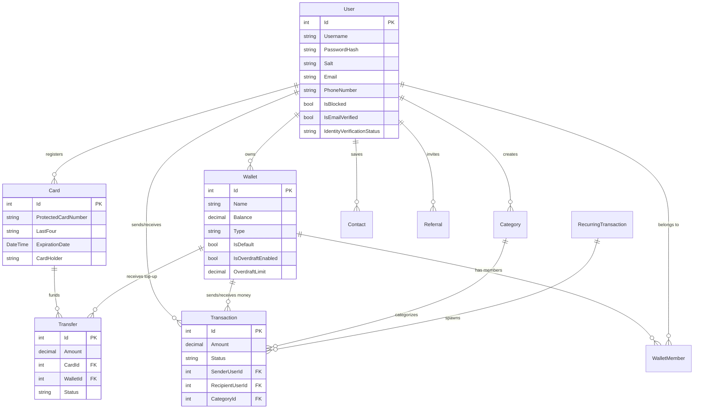

# Virtual Wallet

Virtual Wallet is an ASP.NET Core web application built with C# .NET 10 and Entity Framework Core for managing personal budgets and digital transfers. The platform enables users to send and receive funds user-to-user, fund wallets via payment cards, manage joint and savings accounts, track spending categories, and perform administrative oversight.

## Solution Architecture

The solution uses a tiered, multi-project structure:

- **VirtualWallet.Data**: Domain entities, enums, Entity Framework Core DbContext, migrations, and SQL scripts.
- **VirtualWallet.Business**: Business logic, services, DTOs, and validation rules.
- **VirtualWallet.Web**: ASP.NET Core MVC views and REST API controllers with Swagger documentation.
- **VirtualWallet.DummyApi**: Standalone dummy REST API simulating bank card withdrawals.
- **VirtualWallet.Tests**: xUnit unit testing project covering business service logic.

## Features

### Authentication & Profiles
- Registration and login with cookie authentication for MVC views and JWT tokens for REST API endpoints.
- Profile management (email, phone, photo) with locked username after registration.
- Email verification and identity verification workflows.

### Wallets & Cards
- Credit/debit card registration with card number validation.
- Card-to-wallet funding using the dummy bank REST API.
- Support for multiple wallet types:
  - Personal wallets.
  - Joint wallets with multi-user permissions (spend / add money).
  - Savings wallets with maturity dates and calculated interest rates.
- Overdraft support with configurable interest rates.

### Transfers & Transactions
- User-to-user transfers by username, email, or phone number.
- Pre-transfer confirmation step displaying transfer details.
- High-value transaction verification via one-time verification codes.
- Spending categories and breakdown analytics.
- Automated recurring transactions.
- Multi-currency support (EUR, USD, GBP) with exchange rate conversions.

### Administration
- User management panel to view, search, and block or unblock accounts.
- System-wide transaction listing with filtering by date, sender, recipient, and direction.
- Identity verification submission review.

## Database Schema



## Local Setup

### Prerequisites
- .NET 10 SDK
- Docker Desktop or OrbStack

### 1. Start SQL Server Container
Run SQL Server in Docker:

```bash
docker run -e ACCEPT_EULA=Y -e 'MSSQL_SA_PASSWORD=YourPassword123!' -p 1433:1433 --name mssql -d mcr.microsoft.com/azure-sql-edge
```

### 2. Apply Database Migrations
Apply EF Core migrations to create the database schema and seed initial data:

```bash
dotnet ef database update --project VirtualWallet.Data --startup-project VirtualWallet.Web
```

### 3. Run the Web Application
Start the web application:

```bash
dotnet run --project VirtualWallet.Web
```

ASP.NET Core Data Protection needs its key ring to persist across restarts; losing that key ring makes stored card numbers unreadable.

Card numbers are encrypted before they reach the database. The database stores only the encrypted card number and last four digits for display. CVVs are not stored; funding requests must provide the CVV again.

The web application will be available at `http://localhost:5178`.

## API Documentation

Swagger API documentation is accessible when running the project at:
`http://localhost:5178/swagger`

## Database Scripts

- Database creation script: `VirtualWallet.Data/Scripts/create_database.sql`
- Seed data script: `VirtualWallet.Data/Scripts/seed_data.sql`
