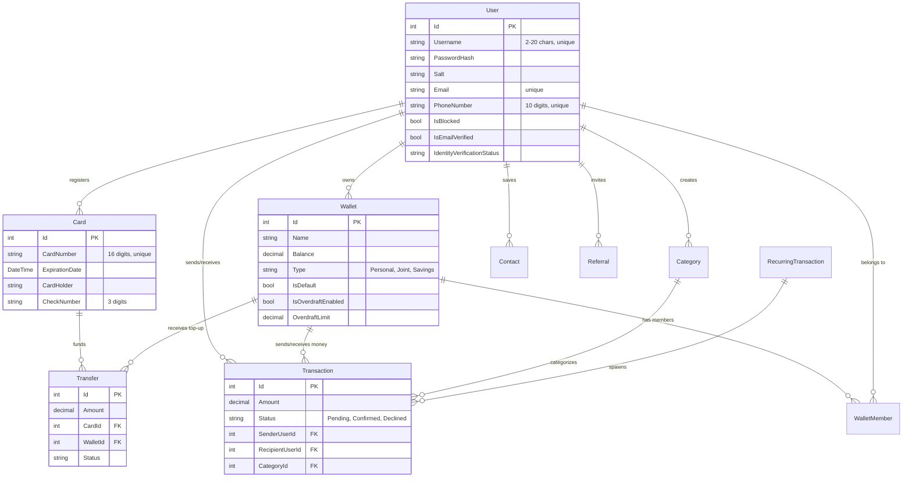

# Virtual Wallet 💳

A full-featured web application built with **C# .NET 10** and **Entity Framework Core** that enables users to manage personal budgets, send and receive money user-to-user, fund wallets via bank cards, manage joint/savings wallets, track spending categories, and perform administrative oversight.

---

## 🏗️ Architecture & Layered Structure

The project follows SOLID principles, OOP best practices, and a **tiered/layered architecture**:

```
VirtualWallet.sln
├── VirtualWallet.Data          # Domain Entities, Enums, DbContext, Mappings, Migrations & Scripts
├── VirtualWallet.Business      # Core Business Logic, Services, DTOs, and Validations
├── VirtualWallet.Web           # ASP.NET Core MVC Views & REST API Controllers (Swagger)
├── VirtualWallet.DummyApi     # Standalone Dummy Bank REST API for Card Top-ups
└── VirtualWallet.Tests         # xUnit BDD Unit Tests (>= 80% coverage)
```

---

## ✨ Features

### 🔑 Public & Account Management
- **Registration & Authentication**: Cookie-based authentication for MVC UI and JWT Tokens for REST API.
- **Profile Management**: Update profile details, photo upload, and view account details (username locked upon registration).
- **Email & Identity Verification**: Verification codes (OTP) and photo ID + selfie approval workflows.

### 💰 Wallet & Cards
- **Card Management**: Register credit/debit cards (16-digit validation, CVV, expiry).
- **Wallet Top-Up (Transfers)**: Fund wallets directly from bank cards via the dummy bank REST API.
- **Multiple Wallet Types**:
  - **Personal**: Standard default individual wallet.
  - **Joint**: Shared wallet with multi-user access and granular permissions (`CanSpend`, `CanAddMoney`).
  - **Savings**: Savings wallets with custom maturity dates and calculated interest rates.
- **Overdraft Support**: Interest rate modifiers, negative balance limits, and overdraft tracking.

### 💸 User-to-User Transfers & Transactions
- **Money Transfers**: Search recipient by **Username**, **Email**, or **Phone Number**.
- **Confirmation Step**: Review transfer details prior to final execution.
- **Large Transaction Security**: Automated OTP code prompt for high-value transactions.
- **Spending Categories & Analytics**: Categorize transfers (Groceries, Rent, Utilities, etc.) and generate breakdown reports.
- **Recurring Transactions**: Automated periodic scheduled payments.
- **Multi-Currency Support**: Real-time cross-currency transfer exchange rates (`EUR`, `USD`, `GBP`).

### 🛡️ Administrative Capabilities
- **User Management**: View paginated list of all users, search by phone/username/email, and block/unblock accounts.
- **Transaction Oversight**: View, filter (date, direction, sender, recipient), and sort all system transactions.
- **Identity Review**: Approve or reject pending identity verification submissions.

---

## 📊 Database Schema & ER Diagram



---

## 🚀 Getting Started & Local Setup

### Prerequisites
- [.NET 10 SDK](https://dotnet.microsoft.com/)
- [Docker Desktop](https://www.docker.com/) (or OrbStack)
- SQL Server Container

### 1. Start SQL Server via Docker
Run the container on port `1433`:
```bash
docker run -e ACCEPT_EULA=Y -e 'MSSQL_SA_PASSWORD=YourPassword123!' -p 1433:1433 --name mssql -d mcr.microsoft.com/azure-sql-edge
```

### 2. Configure Database & Apply Migrations
From the solution root folder, run:
```bash
# Update Database and seed test data
dotnet ef database update --project VirtualWallet.Data --startup-project VirtualWallet.Web
```

### 3. Run the Web Application
```bash
dotnet run --project VirtualWallet.Web
```
Access the application at: **`http://localhost:5178`**

---

## 📖 API Documentation (Swagger)

The REST API is documented using OpenAPI / Swagger:
- **Interactive Swagger UI**: [`http://localhost:5178/swagger`](http://localhost:5178/swagger)

---

## 🧪 Pre-configured Test Accounts

The system comes pre-seeded with test accounts for quick evaluation:

| Account Type | Username | Password / Info | Details |
| :--- | :--- | :--- | :--- |
| **Admin** | `admin` | `admin@virtualwallet.com` | Full Administrative Privileges |
| **User 1** | `john_doe` | `john@virtualwallet.com` | Pre-loaded with 1,000 EUR + Card |
| **User 2** | `jane_smith` | `jane@virtualwallet.com` | Pre-loaded with 500 EUR + Card |

---

## 📜 Database Scripts
- DB Creation Script: [`VirtualWallet.Data/Scripts/create_database.sql`](./VirtualWallet.Data/Scripts/create_database.sql)
- DB Seed Data Script: [`VirtualWallet.Data/Scripts/seed_data.sql`](./VirtualWallet.Data/Scripts/seed_data.sql)
